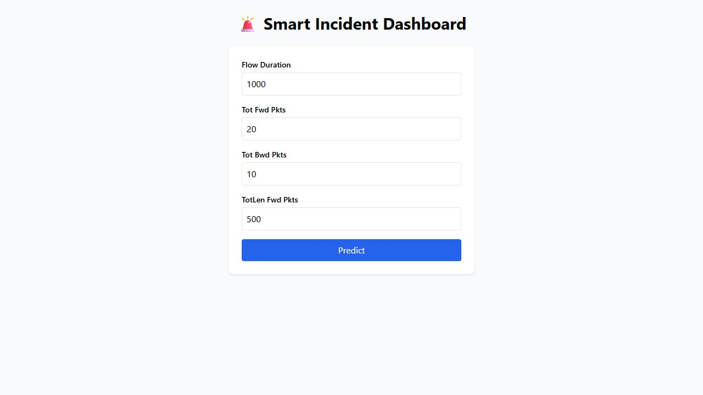
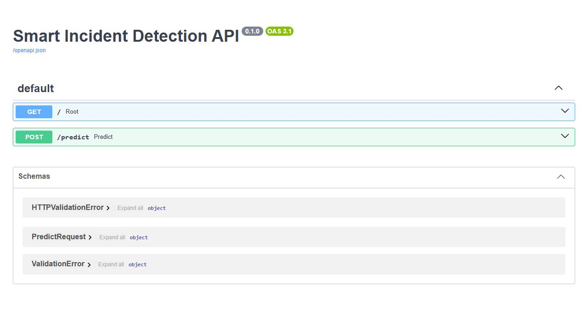

# Smart Incident Detection Dashboard

**From network-flow features to a machine-learning prediction.**

A full-stack learning project by **Antonio Puceski**, connecting a saved scikit-learn Random Forest model to a **FastAPI** service and a **React** dashboard. Enter flow statistics, request a prediction, and inspect the model's class probabilities.

[Demo](#demo) · [Run locally](#run-locally) · [How it works](#how-it-works)



## Demo


[Watch or download the MP4 screen tour](docs/media/demo.mp4?raw=true).

The media shows the real local frontend and API using manually entered example values. These are model outputs, not verified incidents or a live network feed. The silent 12-second video is a slideshow of captured screens.

### Prediction and probability chart


### Interactive API documentation



## Features

- A four-field form for network-flow statistics.
- FastAPI inference endpoint returning a binary class and probability array.
- Recharts visualization of benign and attack class probabilities.
- Saved model and ordered feature schema included in the repository.
- Jupyter notebooks covering exploration, preprocessing, training and deployment testing.
- Built-in Swagger UI for inspecting the API.

## How it works

```text
React form --> POST /predict --> pandas feature alignment
                                      |
                                      v
                         Saved scikit-learn classifier
                                      |
                                      v
                  JSON class + probabilities --> React chart
```

The training notebook defines median imputation, standard scaling and a Random Forest with 200 trees, balanced class weights and a fixed random seed. It uses an 80/20 stratified train/test split and maps benign labels to 0 and all other labels to 1.

At inference time, the API constructs a DataFrame in the order stored in `feature_names.json`. Missing features and nonnumeric values become zero; extra keys are ignored. The model expects **78 features**, while the UI supplies **four**, leaving 74 filled with zero. This is a demonstration of the ML-to-web integration, not a validated production IDS.

| Form field | Meaning |
| --- | --- |
| Flow Duration | Duration of a flow; use the source dataset's measurement convention |
| Tot Fwd Pkts | Number of packets in the forward direction |
| Tot Bwd Pkts | Number of packets in the reverse direction |
| TotLen Fwd Pkts | Total forward packet length in bytes |

The UI does not document or convert duration units. Do not assume milliseconds without checking the feature-extraction source.

## Stack

| Layer | Tools |
| --- | --- |
| Frontend | React, Vite, Tailwind CSS, Axios, Recharts |
| API | Python, FastAPI, Pydantic, Uvicorn |
| Model | scikit-learn, pandas, NumPy, joblib |
| Training | Jupyter, Matplotlib, Seaborn |

## Run locally

Use **Python 3.14** (the runtime verified for this demo), **Node.js 22.12+** and npm. The saved artifact was serialized with scikit-learn 1.7.2; use the matching version in `requirements-runtime.txt`.

```sh
git clone https://github.com/AntonioPuceski/Smart-Incident-Detection-Dashboard-.git
cd Smart-Incident-Detection-Dashboard-
python -m venv .venv
```

Activate the environment:

```powershell
# Windows PowerShell
.\.venv\Scripts\Activate.ps1
```

```sh
# macOS / Linux
source .venv/bin/activate
```

Install the inference dependencies and start FastAPI:

```sh
python -m pip install -r requirements-runtime.txt
python -m uvicorn backend.app:app --host 127.0.0.1 --port 8000
```

In another terminal:

```sh
cd frontend
npm ci
npm run dev -- --host localhost --port 5173 --strictPort
```

Open [http://localhost:5173](http://localhost:5173). Use this exact frontend origin: the backend CORS configuration currently allows localhost:5173, and the frontend API URL is fixed to 127.0.0.1:8000.

- API status: [http://127.0.0.1:8000/](http://127.0.0.1:8000/)
- Interactive API docs: [http://127.0.0.1:8000/docs](http://127.0.0.1:8000/docs)

The original `requirements.txt` contains notebook/data dependencies. It does not install FastAPI or Uvicorn; the runtime requirements file supplies those.

## API example

POST `/predict` with this JSON body:

```json
{
  "data": {
    "Flow Duration": 1000,
    "Tot Fwd Pkts": 20,
    "Tot Bwd Pkts": 10,
    "TotLen Fwd Pkts": 500
  }
}
```

Observed response from the included artifact:

```json
{"prediction": 1, "probability": [1.0], "classes": [1]}
```

Each probability corresponds to the same-index entry in `classes`. Label 0 means benign and 1 means attack. The included model has only class 1; a probability of 1.0 here is **not evidence that a real attack occurred**.

## Model status and limitations

The included `rf_pipeline.joblib` is actually a **100-tree RandomForestClassifier**, not the 200-tree preprocessing pipeline defined in the training notebook. Its stored classes are `[1]`. The model artifact and notebook are therefore not aligned, and the artifact cannot distinguish benign traffic from attacks.

Before using this beyond an integration demo:

1. Verify source labels and ensure both benign and attack examples survive preprocessing.
2. Remove index-like fields such as `Unnamed: 0` from the training feature set; it is currently included in the 78-feature schema.
3. Retrain and export the intended pipeline with its matching feature schema and dependency versions.
4. Evaluate on an independent holdout and report per-class precision, recall, confusion matrix and false-positive rate.
5. Supply a complete, consistently extracted feature vector instead of zero-filling most fields.

There is no live packet capture, stream ingestion, incident history or authentication in this version. Model probabilities are not calibrated incident confidence. Deployment would also require configurable API origins, stricter input validation and error handling.

## Data and notebooks

The notebooks reference `data/cleaned_ids2018_sampled.csv`, which is not included. `download_data.py` downloads a cleaned CICIDS2018 dataset through KaggleHub, but does not implement the sampling step or guarantee that exact filename. Prepare the required CSV and review notebook working directories before running the training workflow.

| Notebook | Purpose |
| --- | --- |
| `0_setup.ipynb` | Inspect working directories and data files |
| `1_explore.ipynb` | Inspect labels, feature types and distributions |
| `2_preprocess_and_train.ipynb` | Prepare features, split data, train, evaluate and export |
| `3_deploy_test.ipynb` | Exercise the deployment workflow |

Install the original `requirements.txt` if you want the notebook tooling. No retraining or benchmark reproduction was performed for these portfolio materials.

## Project layout

```text
backend/app.py                       FastAPI model loading and inference
frontend/src/App.jsx                Form, API request and probability chart
notebooks/                          Exploration and training notebooks
notebooks/models/rf_pipeline.joblib  Included classifier artifact
notebooks/models/feature_names.json  Ordered 78-feature schema
requirements-runtime.txt            Verified inference dependencies
requirements.txt                    Notebook/data dependencies
download_data.py                    KaggleHub dataset download helper
docs/media/                         Screenshots and video tour
```

## Verification

- Frontend production build and ESLint pass.
- Saved model loads with scikit-learn 1.7.2.
- The example request was tested through the running API and browser.
- The chart uses the model's actual class ordering, including its single-class limitation.
- npm reported 26 dependency audit findings during setup; these remain unresolved. The build also warns about a bundle above 500 kB and outdated browser metadata.
- There is no automated test suite or reproduced model-quality benchmark.

To repeat the frontend checks:

```sh
cd frontend
npm run build
npm run lint
```

## Credits

Built by **[Antonio Puceski](https://github.com/AntonioPuceski)** · [Portfolio](https://antoniopuceski.github.io/)

Dataset provenance: CICIDS2018, with a cleaned dataset downloaded via KaggleHub. Consult the dataset providers for usage and attribution terms. Screenshots use manually entered numeric examples rather than private network logs.
